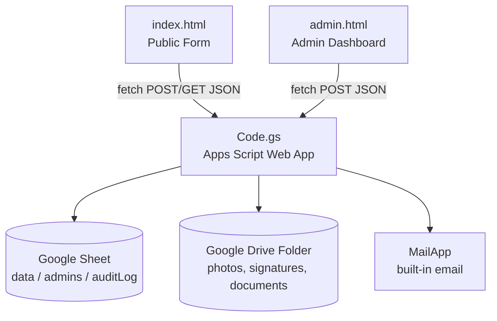
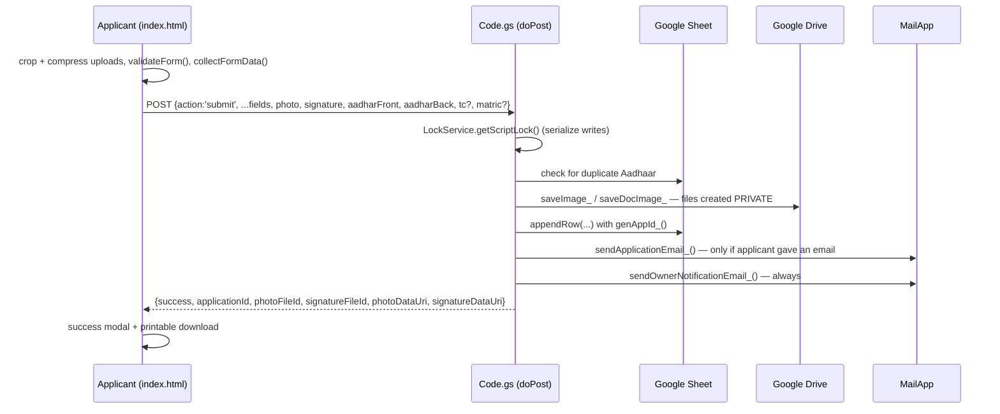

# Architecture

## Overview

The system is a **serverless, three-tier application built entirely on Google's free-tier infrastructure**:



There is no application server, no database server, and no separate hosting. `index.html` and `admin.html` can be hosted anywhere static files can be served (or opened locally), and both talk directly to the Apps Script Web App URL over HTTPS.

---

## Components

### 1. `Code.gs` — the backend

Deployed via **Deploy → New deployment → Web app**, this becomes a single HTTPS endpoint exposing:

- `doGet(e)` — the one unauthenticated read action: `?action=search`.
- `doPost(e)` — a router over a JSON body's `action` field:

| Action | Caller | Purpose |
|---|---|---|
| `submit` | public | New application, or edit (`isEdit: true`) |
| `loadForEdit` | public | Aadhaar + mobile check, returns the record for editing |
| `searchReveal` | public | Exchanges a reveal token + Aadhaar for the full record |
| `adminLogin` | staff | Returns a signed session token |
| `adminList` | staff | Paginated, filtered record list |
| `adminExport` | `admin` only | Full filtered record set for CSV |
| `adminUpdate` | staff | Edit plain fields; `admin` only for file replacement |
| `adminDelete` | staff | Delete a row |
| `getImage` | staff | Fetch one private file's bytes |

Apps Script executes as the account that owns the deployment ("Execute as: Me"), which gives the script permission to read/write the Sheet and Drive folder without visitors needing a Google account.

### 2. Google Sheet — the database

One Spreadsheet (`SHEET_ID` script property) with up to three tabs, each created automatically on first use:

| Tab | Purpose |
|---|---|
| `data` | One row per application. Columns = `HEADERS` array in `Code.gs`. |
| `admins` | Optional. `username`, `passwordHash` (SHA-256, base64), `displayName`. |
| `auditLog` | Append-only. `timestamp`, `username`, `action`, `detail`. |

**Schema evolution:** every read/write looks up columns by *header name* (`headers.indexOf(key)`), never by position. `getSheet_()` compares the sheet's header row with `HEADERS` and **appends** any missing columns at the end. Adding a field to `HEADERS` and redeploying is always safe on a populated sheet; old rows just get a blank value.

Current `data` schema:

```
applicationId, submittedAt, updatedAt, admClass, rollNo, stream,
langGroup, subComp1, subComp2, subElec1, subElec2, subElec3, subAddl,
pen, apaar, aadhar, eshiksha, otr,
studentName, dob, gender, category, religion,
motherName, fatherName, aadharOwner, guardianAadhar, mobile, email,
address, pincode,
distance, cwsn, income, bloodGroup, height, weight,
prevUdise,
bankAccount, ifsc, bankName, accHolder, accRelation,
photoFileId, signatureFileId,
aadharFrontFileId, aadharBackFileId, tcFileId, matricFileId
```

The six `*FileId` columns hold private Drive **file IDs**, not URLs (see below). Rows from before this scheme may still have data under legacy `photoUrl`/`signatureUrl` columns (never removed from the sheet, just no longer in `HEADERS`); `resolveFileId_()` falls back to extracting a file ID from those links.

`rollNo` is a plain optional text field with no special validation. The six subject columns (`subComp1` … `subAddl`) are also plain text as far as the backend is concerned — the stream/subject/code logic lives entirely in `index.html` (see "Class XI/XII subject dropdowns" below).

> **Removed fields:** `deviceInfo`, `geoLocationName`, `geoLocationLink` were removed by request. Rows that already have data under those columns keep it; nothing new is written, and the owner email no longer mentions them.

### 3. Google Drive — file storage (private)

One folder (`DRIVE_FOLDER_ID`) receives every uploaded file, named `<applicationId>_photo`, `_signature`, `_aadharFront`, `_aadharBack`, `_tc`, `_matric` (with the image extension). **Files are never given public sharing.** They stay private to the account that owns the deployment, so the script can always read them via `DriveApp.getFileById(id).getBlob()` while nobody else can reach them directly.

### 4. `MailApp` — email

Apps Script's built-in mail service, used for two independent notification paths (see [Email notifications](#email-notifications)). Sending quota is whatever the owner's Google account allows.

### 5. `index.html` / `admin.html` — the frontend

Plain HTML/CSS/vanilla JS, single files, no build step. Both hard-code the deployed URL in `CONFIG.WEB_APP_URL`.

### 6. `hash-generator.html` — optional offline utility

Not part of the live request flow. Produces `admins`-sheet-ready rows (username, SHA-256 hash, display name) using the browser's `crypto.subtle.digest('SHA-256', ...)` — the same algorithm as `hashPassword_()` in `Code.gs`.

---

## File storage & access model

Every uploaded file is a **private** Drive file. No URL anywhere in this system lets someone view an applicant's image by itself. Bytes are handed out in only two ways, both gated on the requester having already proven entitlement:

1. **Embedded inline** as a base64 data URI inside a response the server was already sending to someone who just proved entitlement in that same request — a successful submission, a matching Aadhaar+mobile edit-lookup, or a confirmed search reveal.
2. **Fetched lazily by an authenticated admin**, one file at a time, via `getImage` — called only when staff open a record or its edit modal, never bundled into the list or CSV export.

```mermaid
sequenceDiagram
    participant U as Applicant's browser
    participant W as Code.gs
    participant D as Drive (private file)

    Note over U,W: Submitting (new upload)
    U->>U: auto crop & straighten, then compress
    U->>W: photo = data:image/jpeg;base64,...
    W->>D: createFile(blob) — NOT publicly shared
    D-->>W: fileId
    W-->>U: {photoFileId, photoDataUri}

    Note over U,W: Editing later (file untouched)
    U->>W: photo = <bare fileId string, not new bytes>
    W->>W: saveImage_() sees an existing fileId — reuse, no re-upload
    W->>D: getBlob() — only to re-encode for display
    W-->>U: {photoFileId, photoDataUri}
```

**Photo and signature** go through `saveImage_()`. **Supporting documents** go through `saveDocImage_()`, which wraps it with one extra rule: a bare file ID is accepted only if it is the very file already stored on *that application's own row*. Any other bare ID is ignored, so an applicant can't point their record at somebody else's file.

On the public form, `index.html` tracks **two values** per image: the value that gets *resubmitted* (fresh base64, or the existing bare fileId if untouched) and the value that gets *displayed* (always a real data URI). They must stay separate because a bare fileId is not a valid ``.

**Scope note:** this governs files going forward. Anything uploaded *before* private storage was introduced was publicly shared at creation and is not automatically re-locked. Old applications keep working through the legacy-URL fallback, and editing one upgrades its row — but the original file remains publicly linkable until re-locked (SETUP_GUIDE.md step 11).

**`importLegacyData_()`** has the same gap if it just copies a URL as text. `migrateLegacyImage_()` avoids it by saving a **fresh private copy** into this deployment's folder (via the `photoUrl`/`signatureUrl` keys of `COLUMN_MAP`); the original old file is left untouched.

**Not cleaned up automatically:** deleting a record removes only the sheet row, and replacing a file leaves the previous one in Drive.

---

## Auto crop & straighten (client-side)

Both `index.html` and `admin.html` contain the same self-contained crop module. For every upload it opens a full-screen crop screen *before* compression:

1. The photo is downscaled to ≤ 3000 px and shown on a canvas.
2. **Auto-detect:** a small copy (≤ 480 px) is blurred heavily (removing printed text), thresholded with Otsu's method, and the largest convex four-sided region is taken as the document. Both a bright-on-dark and dark-on-bright document are tried. If nothing plausible is found, the corners start near the image edges and the user is told to drag them.
3. The user can drag any corner (with a magnifier loupe), rotate, reset to the full image, or switch to a plain rectangular crop.
4. **Crop & Straighten** solves a perspective transform (homography) and resamples the region into a flat, upright image (max 2400 px), returned as a JPEG blob.
5. The blob continues into the normal pipeline: fixed-size resize for photo/signature, or aspect-preserving compression to ~200 KB for documents.

If the crop screen fails to open, the original file is used. `AUTO_CROP_FIELDS` (near the module) can switch it off per field. Cancelling the crop discards the selection and leaves any existing file unchanged.

`index.html` applies it to photo, signature, Aadhaar front/back, TC and Matric. `admin.html` applies it to the same six slots in the edit modal. All of this runs in the browser; the server only ever receives the final compressed image.

---

## Request flows

### Submitting a new application



Only the documents that apply to the chosen class are sent (Aadhaar front/back always; TC for Class IX; Matric for Class XI). Aadhaar images are optional for Class I.

### Editing an existing application (public)

Same `submit` action with `isEdit: true` and `applicationId`. The applicant first passes **`loadForEdit`** (Aadhaar + mobile match, rate-limited), whose response embeds data URIs for display and file IDs for resubmission. `handleSubmit_` then updates the row in place. For documents, if nothing new is supplied on an edit, the value already stored on the row is kept. `sendOwnerNotificationEmail_` fires again with `isEdit: true`.

### Public search → masked preview → reveal

```mermaid
sequenceDiagram
    participant U as Applicant (index.html)
    participant W as Code.gs (doGet / doPost)
    participant S as Google Sheet
    participant D as Drive (private file)

    U->>W: GET ?action=search&class&dob&type&value
    W->>W: checkSearchRateLimit_() (per search key)
    W->>S: find matching row (class + DOB + AppID/PEN)
    W-->>U: {found, preview: maskRecordForPreview_(record), revealToken}
    Note over W: preview has no file IDs at all (photo, signature, documents blanked)
    U->>U: masked confirm screen; applicant types their 12-digit Aadhaar
    U->>W: POST {action:'searchReveal', applicationId, revealToken, aadhar}
    W->>W: verifyRevealToken_() (HMAC + 3-min expiry + appId match)
    W->>W: checkSearchRateLimit_('reveal_'+applicationId)
    W->>W: compare supplied Aadhaar to the record's (digits only)
    alt mismatch
        W-->>U: {success:false, error}
    else match
        W->>D: imageDataUri_() for photo + signature
        W-->>U: {success, record} — unmasked, photo/signature embedded
        U->>U: buildPrintableApplication()
    end
```

The reveal token is HMAC-signed, scoped to one `applicationId`, and expires in `REVEAL_TOKEN_TTL_MINUTES` (default 3). Requiring the applicant's own Aadhaar at reveal time raises the bar above class+DOB+ID/PEN, which a classmate or relative might know; it is rate-limited on its own key so a valid token can't be used to brute-force it. The reveal embeds photo and signature only; documents are not included in the printable copy.

### Admin login, session, and viewing images

```mermaid
sequenceDiagram
    participant A as Staff (admin.html)
    participant W as Code.gs (doPost)
    participant S as Google Sheet (admins / auditLog)
    participant C as CacheService
    participant D as Drive (private file)

    A->>W: POST {action:'adminLogin', username, password}
    W->>C: isLockedOut_(username)
    W->>S: verifyAdminCredentials_() — admins tab, or legacy ADMIN_PASSWORD
    alt invalid
        W->>C: recordFailedAttempt_() — backoff, maybe lockout
        W->>S: logAudit_('login_failed')
        W-->>A: {success:false, error}
    else valid
        W->>C: clearFailedAttempts_()
        W->>S: logAudit_('login_success')
        W-->>A: {success:true, token, username, displayName, expiresAt}
        A->>A: sessionStorage; header shows "Version: ... · Logged in as: ..."
    end

    Note over A,W: Later — staff opens a record
    A->>W: adminList — records carry bare file IDs, no bytes
    A->>W: getImage {token, fileId} (once per image)
    W->>W: requireAdminToken_()
    W->>D: imageDataUri_(fileId)
    W-->>A: {success, dataUri}
```

Every admin action sends the `token` instead of the password; `requireAdminToken_()` verifies its HMAC and expiry first. The token lives in `sessionStorage` (cleared when the tab closes). `getImage` fetches exactly one file per call, and the same call serves photo, signature and all documents.

### Admin edit (`adminUpdate`)

```mermaid
sequenceDiagram
    participant A as Staff (admin.html)
    participant W as Code.gs
    participant S as Google Sheet
    participant D as Drive

    A->>A: open edit modal; "admin" account also sees 6 upload boxes
    A->>A: choose file → crop & straighten → compress → hold in memory
    A->>W: POST {action:'adminUpdate', token, applicationId, fields, [photo, signature, aadharFront, aadharBack, tc, matric]}
    W->>W: requireAdminToken_(); LockService
    W->>S: find row by applicationId
    W->>W: apply fields (skip blocked columns; normalize dob / aadhar / otr)
    alt username is "admin"
        W->>D: saveImage_() for each fresh data: upload — new private file
        W->>W: write new *FileId into the row
    else any other account
        W->>W: file inputs silently ignored
    end
    W->>S: setValues(row) + updatedAt
    W->>S: logAudit_('admin_update', applicationId + files replaced)
    W-->>A: {success, photoFileId, signatureFileId, aadharFrontFileId, aadharBackFileId, tcFileId, matricFileId}
    A->>A: update the in-memory row so the dashboard reflects it immediately
```

- **Plain fields** — the edit modal is one text input per field (same set `fieldLabels` shows in the View modal). Any admin may do this. `handleAdminUpdate_` never writes `applicationId`, `submittedAt`, `updatedAt`, any `*FileId` column, or the legacy `photoUrl`/`signatureUrl` columns through `fields`. It normalizes `dob` to dd/mm/yyyy and strips non-digits from `aadhar` and `otr`. It does **not** re-run the public form's validation or the duplicate-Aadhaar check.
- **File replacement** — only the account whose username is `admin` (case-insensitive). The check is server-side; `admin.html` also hides the boxes for other accounts, but that is a convenience, not the boundary. Only fresh `data:` image URLs are accepted — a bare file ID in these inputs is ignored — and each goes through `saveImage_()` as a brand-new private file. The old file is left in Drive.
- **Class-aware slots** — the TC box shows only while the modal's class value is `Class IX`, the Matric box only for `Class XI`; a pending TC/Matric upload is dropped if the class no longer matches when saving.

---

## Security model

| Concern | Mechanism |
|---|---|
| Admin password reuse across requests | Signed session token (HMAC-SHA256) replaces the password after login; `TOKEN_TTL_MINUTES` (default 60) |
| Brute-forcing admin login | Per-username lockout after `MAX_LOGIN_ATTEMPTS` (5) for `LOGIN_LOCKOUT_MINUTES` (15); growing `Utilities.sleep()` per failure |
| Brute-forcing public search / edit-lookup | `checkSearchRateLimit_()` — sliding-window counter via `CacheService`, `SEARCH_MAX_ATTEMPTS_PER_KEY` per `SEARCH_WINDOW_MINUTES` |
| Someone who knows class+DOB+ID/PEN getting the full record | Reveal additionally requires the applicant's own 12-digit Aadhaar, checked server-side, rate-limited on its own key |
| Leaking sensitive fields to an unauthenticated searcher | `maskRecordForPreview_()` masks Aadhaar, guardian Aadhaar, mobile, bank account, IFSC and blanks every file-ID column (photo, signature, 4 documents) plus the legacy URL columns |
| Forging/replaying a reveal or session token | `base64(payload).hmac(payload)`; secret `ADMIN_TOKEN_SECRET` auto-generated in Script Properties |
| Concurrent writes corrupting data | `LockService.getScriptLock()` around submit, update and delete |
| Duplicate applications | Aadhaar uniqueness check in `handleSubmit_` (edit offered instead) |
| Deleting the wrong row after data shifted | `handleAdminDelete_` re-checks the row's `applicationId` |
| Applicant pointing their record at someone else's file | `saveDocImage_()` accepts a bare file ID only if it's already on that application's own row |
| Admin edit touching identity/file fields via `fields` | Blocked-column list in `handleAdminUpdate_` |
| File replacement restricted to one account | `handleAdminUpdate_` acts on file inputs only if `auth.username` is literally `admin` (case-insensitive); others are ignored. UI also hides the boxes |
| Export restricted to one account | `handleAdminExport_` checks the same; UI also hides the button |
| Accountability for admin actions | Append-only `auditLog`: logins, failed logins, exports, deletes, `admin_update` (with files replaced), public search reveals |
| Image upload abuse | `saveImage_()` accepts only `image/jpeg`, `image/png`, `image/webp` data URLs; others rejected with a field-level error |

### What the system deliberately does *not* do

- Does not try to identify the visitor's Google account.
- Does not collect browser-reported device info or geolocation (both removed by request).
- Does not delete Drive files when a record is deleted or a file is replaced.

---

## Email notifications

Two independent paths fire from `handleSubmit_`, each in its own `try/catch` so a mail failure never fails the submission:

1. **Applicant confirmation** (`sendApplicationEmail_`) — only if `body.email` is present and passes a basic regex. Fires on new submissions and edits. Contains serial no., Application ID, student name, class, roll no.
2. **Owner/staff notification** (`sendOwnerNotificationEmail_`) — unconditional, on every submission and edit. Recipient is `OWNER_NOTIFY_EMAIL` if set, otherwise the deploying account (`Session.getEffectiveUser().getEmail()`). Same contents.

Both use the same `serialNo`, computed once after the row is written. Admin edits through the dashboard do **not** send email (they are recorded in `auditLog`).

`SMS_ENABLED` gates a third, disabled path (`sendSmsNotification_`) with a commented example for a provider like MSG91.

---

## Class XI/XII subject dropdowns

For Class XI/XII, `index.html` builds six dependent `<select>`s from a hard-coded `SUBJECT_DATA` table (`Arts`, `Science`, `Commerce`) transcribed from BSEB's "Subject details with their numerical codes" sheets. Each entry is `[subjectName, code]`, grouped into `comp1`, `comp2`, `elective`, `additional`.

**Codes differ between groups:** a subject in more than one group doesn't necessarily keep its code (Science: Urdu is `107` in Compulsory Group-2 but `126` in Additional). So every "already picked elsewhere" check compares by **subject name only** (`subjectNameOf()` strips the trailing `" (code)"`).

**Rules enforced automatically:**
- Compulsory Group-2 excludes Group-1's choice.
- The three Electives exclude each other.
- Additional excludes all five of the above.

`refreshSubjectDropdowns()` rebuilds all six on any change, and `rebuildSubjectSelect()` keeps a selection only if it's still valid. The stored value is `"SubjectName (Code)"`, e.g. `"Hindi (306)"` — plain text as far as `Code.gs` is concerned.

**Caveat:** applications from before this redesign hold free-text subjects that won't match any option, so those six fields come up blank when loaded for public editing and must be re-selected. The old values remain visible in the dashboard and CSV. Note that the admin edit modal uses plain text inputs for subjects, so staff can still correct these directly.

---

## Extending the schema

To add a new form field:
1. Add its key to `HEADERS` in `Code.gs` (existing sheets get the column appended automatically).
2. Add the input to `index.html` and its key to `fieldLabels` there.
3. Add the key to `fieldLabels` in `admin.html` so staff can see and edit it.
4. No change needed in `handleSubmit_`'s row building — it falls through to `body[key]` for any unspecialized header.

To add a new **document upload**: add an entry to `DOC_FIELDS` in `Code.gs` and the matching `*FileId` header to `HEADERS`; add the field block, `DOCS` entry and `neededDocs()` rule in `index.html`; add its slot to the `slots` list in `admin.html`'s edit modal and to `fileSpecs` in `handleAdminUpdate_`; and add the key to the document row in `openViewModal`.
